```{r setup, include=FALSE}
knitr::opts_chunk$set(echo = TRUE, fig.align = "center", message = FALSE, warning = FALSE)
library(caret)
library(tidyverse)
library(e1071)
```

## Learning objectives
\Large
By the end of this lecture you should be able to:

* Explain the maximum-margin hyperplane and support vectors
* Explain the soft margin and how the cost $C$ trades bias for variance
* Explain the kernel trick (linear, polynomial, radial kernels)
* Fit SVMs in R with `e1071` and tune them with `caret`
* Build and evaluate an SVM classifier for TB from blood gene expression

## Support vector machines
\Large
* **SVMs** are supervised learning models for classification (and regression)
* Goal: find the **decision boundary** (separating **hyperplane**) that best separates two classes

\footnotesize
Adapted from: [datacamp.com/tutorial/support-vector-machines-r](https://www.datacamp.com/tutorial/support-vector-machines-r); *The Elements of Statistical Learning* (Hastie, Tibshirani & Friedman), Ch. 12; *An Introduction to Statistical Learning* (James et al.), Ch. 9

## Linearly separable data
Two classes (red and blue) and two features, $x$ and $y$:

\center
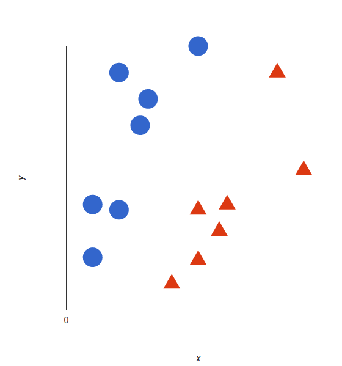{width=35%}

## The decision boundary
An SVM finds the **hyperplane** (in two dimensions, a line) that separates the classes:

\center
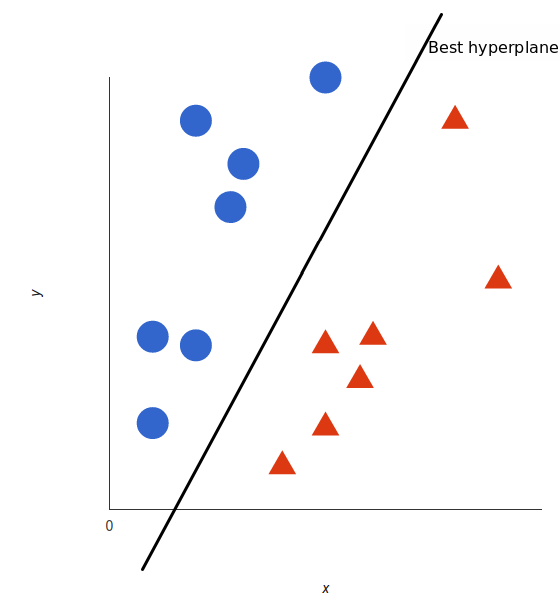{width=35%}

## The best hyperplane: maximum margin
The best hyperplane is the one with the largest **margin**, the distance to the closest points of each class:

\center
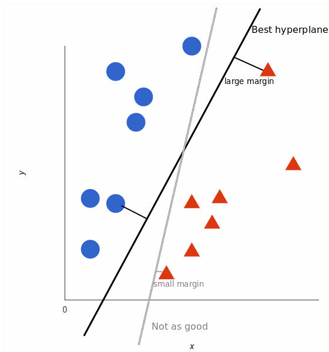{width=35%}

## The maximum-margin classifier
\center
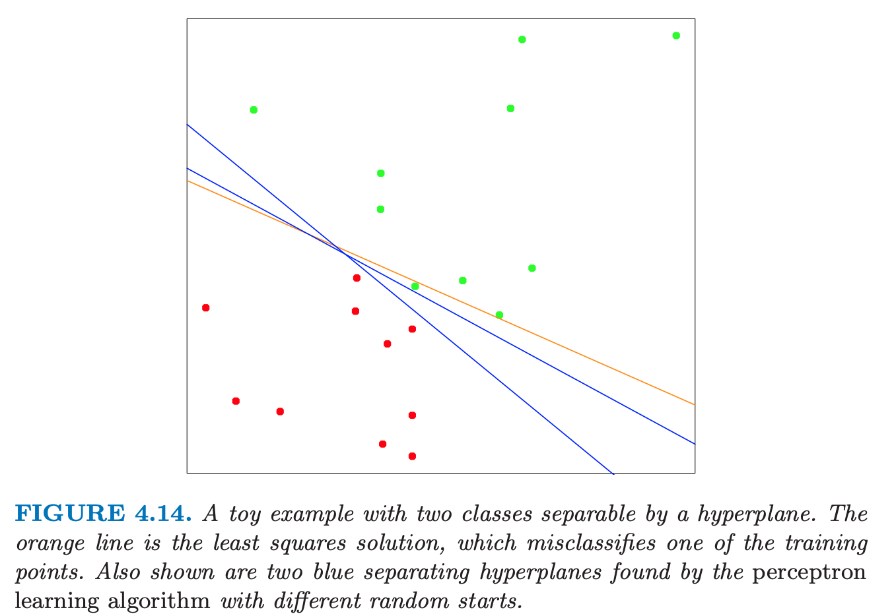{width=60%}

## The maximum-margin classifier
\Large
For $y_i \in \{-1, 1\}$, find the hyperplane $\beta_0 + x^T\beta = 0$ that solves
$$\max_{\beta_0, \beta,\ \|\beta\|=1} M \quad \text{subject to} \quad y_i(\beta_0 + x_i^T\beta) \ge M \text{ for all } i$$

* $M$ is the margin
* Only the points **on** the margin matter: the **support vectors**
* Predict with the sign of $\beta_0 + x^T\beta$

## When classes overlap: the soft margin
\center
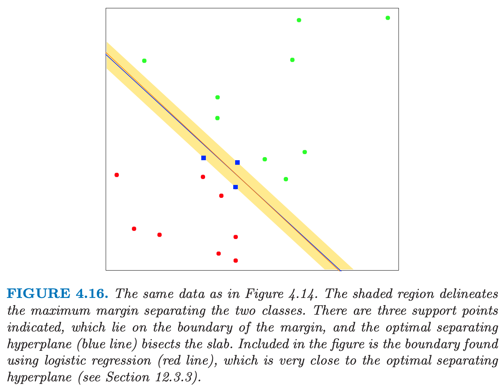{width=60%}

## The soft margin and the cost $C$
\Large
Allow some points inside the margin or on the wrong side, with **slack** $\xi_i \ge 0$, and charge a cost for it:
$$\min_{\beta_0, \beta} \ \tfrac{1}{2}\|\beta\|^2 + C\sum_{i=1}^N \xi_i \quad \text{subject to} \quad y_i(\beta_0 + x_i^T\beta) \ge 1 - \xi_i$$

* **Large $C$:** few violations allowed, narrow margin, low bias, high variance
* **Small $C$:** wide margin, more violations, higher bias, lower variance
* Tune $C$ by cross-validation

## SVM as regularized regression
\Large
The soft-margin SVM is equivalent to minimizing
$$\sum_{i=1}^N \max\left[0,\ 1 - y_i(\beta_0 + x_i^T\beta)\right] + \lambda\|\beta\|^2$$

* **Hinge loss:** zero for points correctly classified outside the margin
* Plus an **L2 (ridge) penalty**, with $\lambda$ playing the role of $1/C$
* Same idea as the regularization lecture, with a different loss

## Support vector machines in R
\Large
Simulate two slightly separated classes in two dimensions:

\normalsize
```{r sim-data, fig.show='hide'}
set.seed(10111)
x <- matrix(rnorm(40), 20, 2)
y <- rep(c(-1, 1), c(10, 10))
x[y == 1, ] <- x[y == 1, ] + 1
plot(x, col = y + 3, pch = 19)
```

## Support vector machines in R
```{r sim-data-plot, echo=FALSE, out.width="55%", fig.width=5, fig.height=4.5}
par(mar = c(4, 4, 1, 1))
plot(x, col = y + 3, pch = 19, xlab = "X1", ylab = "X2")
```

## Fitting a linear SVM with `e1071`
\small
`svm()` needs $y$ as a factor. We set `scale = FALSE` because both features are already on the same scale; usually you **should** scale (the default).
```{r linear-svm}
dat <- data.frame(x, y = as.factor(y))
svmfit <- svm(y ~ ., data = dat, kernel = "linear", cost = 10,
              scale = FALSE)
svmfit$tot.nSV          # number of support vectors
```

\normalsize
The `r svmfit$tot.nSV` support vectors are the points on, inside, or beyond the margin.

## Plotting the decision boundary
\small
Predict on a grid of points to show the regions:
```{r grid}
make.grid <- function(x, n = 75) {
  grange <- apply(x, 2, range)
  expand.grid(X1 = seq(grange[1, 1], grange[2, 1], length = n),
              X2 = seq(grange[1, 2], grange[2, 2], length = n))
}
xgrid <- make.grid(x)
ygrid <- predict(svmfit, xgrid)
```

## Plotting the decision boundary
\Large
The linear coefficients come from the support vectors; the boundary is $\beta_0 + x_1\beta_1 + x_2\beta_2 = 0$, and the margins are where it equals $\pm 1$:

\normalsize
```{r coefs}
beta  <- drop(t(svmfit$coefs) %*% x[svmfit$index, ])
beta0 <- svmfit$rho
```

## Plotting the decision boundary
```{r boundary, echo=FALSE, out.width="48%", fig.width=5, fig.height=4.5}
par(mar = c(4, 4, 1, 1))
plot(xgrid, col = c("red", "blue")[as.numeric(ygrid)], pch = 20, cex = .2)
points(x, col = y + 3, pch = 19)
points(x[svmfit$index, ], pch = 5, cex = 2)
abline(beta0 / beta[2], -beta[1] / beta[2])
abline((beta0 - 1) / beta[2], -beta[1] / beta[2], lty = 2)
abline((beta0 + 1) / beta[2], -beta[1] / beta[2], lty = 2)
```

\center
\small Solid line: boundary. Dashed lines: margin. Diamonds: support vectors.

## The cost $C$ changes the margin
```{r cost-compare, echo=FALSE, out.width="90%", fig.width=10, fig.height=4}
par(mfrow = c(1, 3), mar = c(4, 4, 2, 1))
for (cc in c(0.01, 1, 100)) {
  f <- svm(y ~ ., data = dat, kernel = "linear", cost = cc, scale = FALSE)
  b <- drop(t(f$coefs) %*% x[f$index, ]); b0 <- f$rho
  g <- predict(f, xgrid)
  plot(xgrid, col = c("red", "blue")[as.numeric(g)], pch = 20, cex = .2,
       main = paste0("C = ", cc, " (", f$tot.nSV, " support vectors)"))
  points(x, col = y + 3, pch = 19); points(x[f$index, ], pch = 5, cex = 2)
  abline(b0 / b[2], -b[1] / b[2])
  abline((b0 - 1) / b[2], -b[1] / b[2], lty = 2)
  abline((b0 + 1) / b[2], -b[1] / b[2], lty = 2)
}
```

\normalsize
Small $C$: wide margin, many support vectors. Large $C$: narrow margin, few support vectors.

## Non-linear data
Often the classes can't be separated by a line:

\center
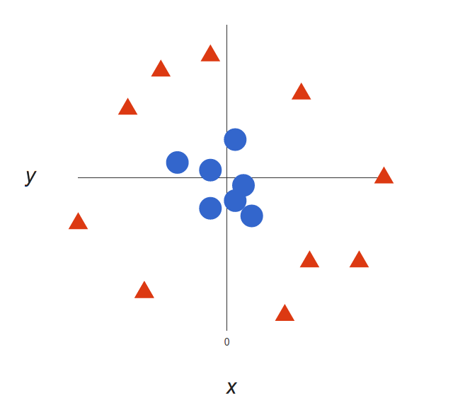{width=40%}

## Adding a dimension
Add a third feature, $z = x^2 + y^2$ (the squared distance from the center), and plot $x$ vs. $z$:

\center
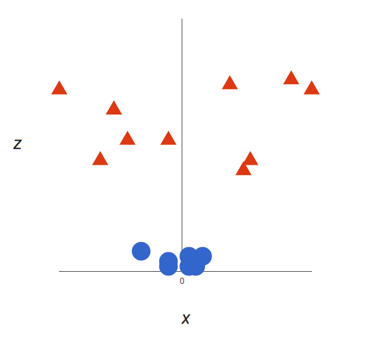{width=40%}

## Adding a dimension
Now a flat hyperplane separates the classes:

\center
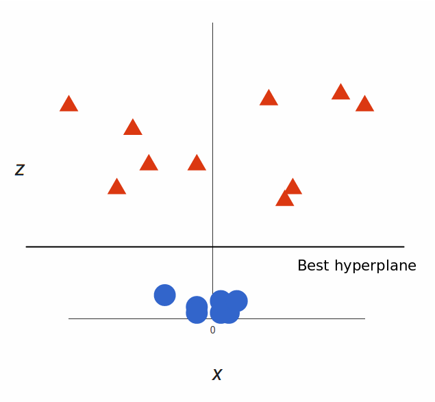{width=35%}

## Mapping back to two dimensions
In the original space, the boundary is a circle:

\center
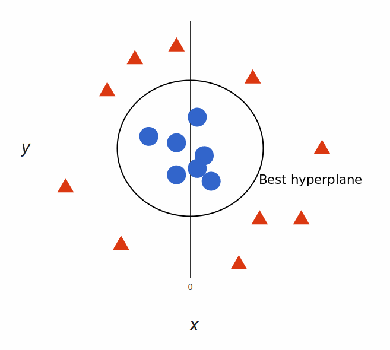{width=50%}

## The kernel trick
\Large
* Computing new features explicitly is expensive
* But the SVM only needs **dot products** between points, $\langle x_i, x_j\rangle$
* A **kernel** $K(x_i, x_j)$ computes the dot product in the enlarged space directly

## Common kernels
\Large
\begin{tabular}{ll}
\hline
\textbf{Kernel} & $K(x_i, x_j)$ \\
\hline
Linear & $\langle x_i, x_j \rangle$ \\
Polynomial & $(1 + \langle x_i, x_j \rangle)^d$ \\
Radial (RBF) & $\exp(-\gamma\|x_i - x_j\|^2)$ \\
\hline
\end{tabular}

\vspace{0.2in}
Radial kernel: $\gamma$ (caret calls it `sigma`) sets how local the boundary is. Large $\gamma$: wiggly boundary, risk of overfitting.

## Kernels: a look at the methodology
\center
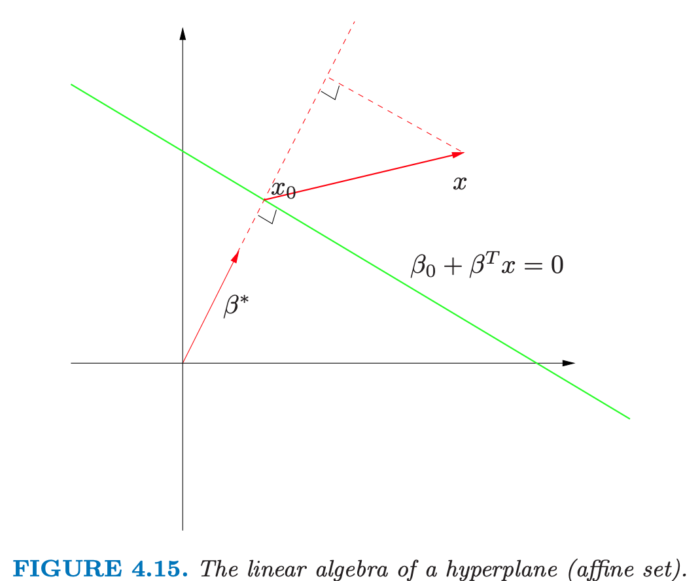{width=60%}

## Kernels: a look at the methodology
\center
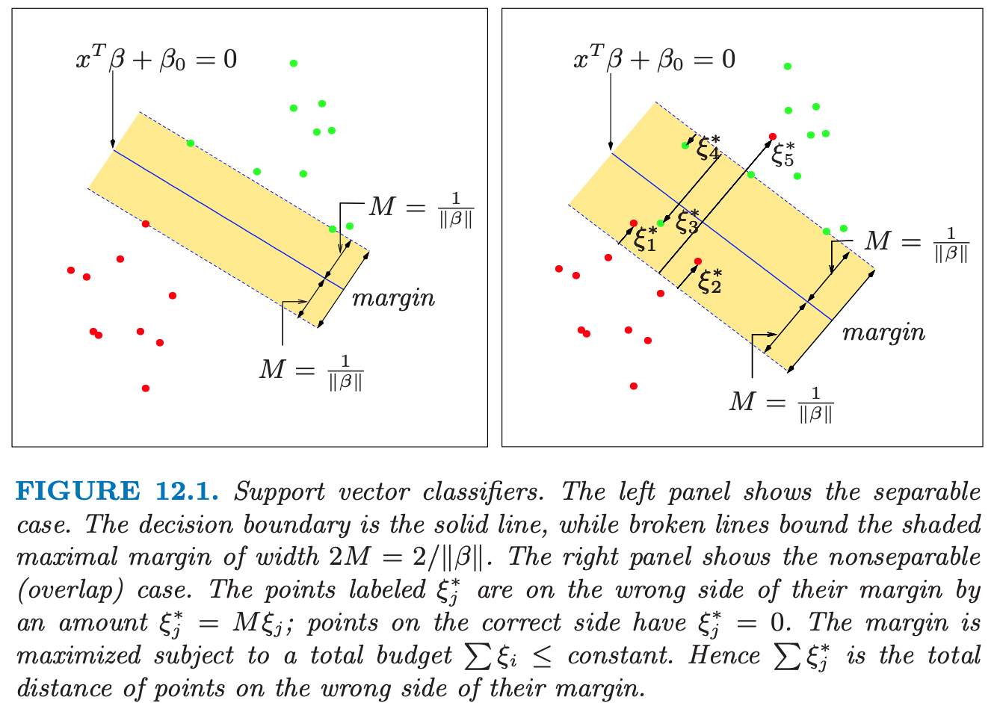{width=60%}

## Non-linear SVM: polynomial kernel
\small
The same simulated data with a polynomial kernel:
```{r poly, fig.show='hide'}
svmfit_poly <- svm(y ~ ., data = dat, kernel = "polynomial",
                   cost = 10, scale = FALSE)
ygrid <- predict(svmfit_poly, xgrid)
plot(xgrid, col = c("red", "blue")[as.numeric(ygrid)],
     pch = 20, cex = .2)
points(x, col = y + 3, pch = 19)
points(x[svmfit_poly$index, ], pch = 5, cex = 2)
```

## Non-linear SVM: polynomial kernel
```{r poly-plot, echo=FALSE, out.width="55%", fig.width=5, fig.height=4.5}
par(mar = c(4, 4, 1, 1))
plot(xgrid, col = c("red", "blue")[as.numeric(ygrid)], pch = 20, cex = .2)
points(x, col = y + 3, pch = 19)
points(x[svmfit_poly$index, ], pch = 5, cex = 2)
```

## Non-linear SVM: the ESL mixture data
\large
A harder example from *The Elements of Statistical Learning*: no clean separation, and the boundary must be non-linear.

\normalsize
```{r esl}
load("ESL.mixture.rda")
str(ESL.mixture[c("x", "y", "px1", "px2")], give.attr = FALSE)
dat_esl <- data.frame(y = factor(ESL.mixture$y), ESL.mixture$x)
```

## Non-linear SVM: the ESL mixture data
```{r esl-plot, echo=FALSE, out.width="55%", fig.height=4.5, fig.width=6}
par(mar = c(4, 4, 1, 1))
plot(ESL.mixture$x, col = ESL.mixture$y + 1, xlab = "X1", ylab = "X2")
```

## Radial-kernel SVM
\small
Fit a radial SVM, then predict on the grid supplied with the data:
```{r esl-fit}
fit <- svm(y ~ ., data = dat_esl, scale = FALSE, kernel = "radial",
           cost = 5)
xgrid_esl <- expand.grid(X1 = ESL.mixture$px1, X2 = ESL.mixture$px2)
func <- predict(fit, xgrid_esl, decision.values = TRUE)
func <- attributes(func)$decision
fit$tot.nSV
```

## Radial-kernel SVM
```{r esl-contour, echo=FALSE, out.width="60%", fig.height=4.5, fig.width=6}
par(mar = c(4, 4, 1, 1))
ygrid_esl <- predict(fit, xgrid_esl)
plot(xgrid_esl, col = as.numeric(ygrid_esl), pch = 20, cex = .2)
points(ESL.mixture$x, col = ESL.mixture$y + 1, pch = 19)
contour(ESL.mixture$px1, ESL.mixture$px2, matrix(func, 69, 99),
        level = 0, add = TRUE, lwd = 2)
```

## Application: TB gene expression biomarkers
\Large
Back to the TB NanoString data: 179 people with active TB or latent TB infection (LTBI), 107 blood genes.

* Can an SVM classify TB status from the full gene panel?
* Linear vs. radial kernel
* Tune $C$ (and $\gamma$) by cross-validation; evaluate on a held-out test set

## TB data: first, a look with PCA
```{r tb-pca, echo=FALSE, out.width="48%", fig.height=4, fig.width=6}
tb <- readRDS("TBnanostring.rds")
tb$TB_Status <- factor(tb$TB_Status, levels = c("LTBI", "TB"))
pca_out <- prcomp(tb[, -1], scale. = TRUE)
data.frame(pca_out$x[, 1:2], Condition = tb$TB_Status) %>%
  ggplot(aes(PC1, PC2, color = Condition)) + geom_point()
```

\large
TB and LTBI overlap in the first two PCs: we need more than two dimensions.

## Tuning SVMs with caret
\scriptsize
Scale the genes inside CV (`preProcess`), tune $C$ for the linear kernel and ($C$, $\gamma$) for the radial kernel, choosing by AUC:
```{r tb-svm}
set.seed(1)
idx <- createDataPartition(tb$TB_Status, p = 0.7, list = FALSE)
tb_train <- tb[idx, ]; tb_test <- tb[-idx, ]
ctrl <- trainControl(method = "cv", number = 10, classProbs = TRUE,
                     summaryFunction = twoClassSummary)
set.seed(1)
svm_lin <- train(TB_Status ~ ., data = tb_train, method = "svmLinear",
                 preProcess = c("center", "scale"), metric = "ROC",
                 trControl = ctrl,
                 tuneGrid = data.frame(C = c(0.001, 0.01, 0.1, 1, 10)))
set.seed(1)
svm_rad <- train(TB_Status ~ ., data = tb_train, method = "svmRadial",
                 preProcess = c("center", "scale"), metric = "ROC",
                 trControl = ctrl, tuneLength = 8)
```

## Tuning the cost $C$
\normalsize
```{r tb-lin-results}
svm_lin$results[, c("C", "ROC")]
```

\Large
The **smallest** costs (widest margins) win: with 107 genes and 125 training samples, strong regularization helps, just as in the regularization lecture.

## Test-set performance
\small
```{r tb-test}
library(pROC)
test_perf <- function(m) {
  p  <- predict(m, tb_test, type = "prob")[, "TB"]
  cm <- confusionMatrix(predict(m, tb_test), tb_test$TB_Status,
                        positive = "TB")
  r  <- roc(tb_test$TB_Status, p, levels = c("LTBI", "TB"),
            direction = "<", quiet = TRUE)
  c(AUC = as.numeric(auc(r)), cm$byClass[c("Sensitivity", "Specificity")]) }
```

## Test-set performance
\normalsize
```{r tb-test-res}
round(rbind(linear = test_perf(svm_lin),
            radial = test_perf(svm_rad)), 3)
```

\Large
Both kernels reach test AUC around 0.92-0.93, similar to kNN and the 3-gene score from earlier lectures. The extra flexibility of the radial kernel doesn't buy much here.

## Probabilities from an SVM
\Large
* An SVM gives a **class** (which side of the boundary), not a probability
* `classProbs = TRUE` fits **Platt scaling**: a logistic regression on the SVM's decision values
* That is what let us compute ROC curves and AUC above

## Strengths and weaknesses of SVMs
\Large
**Strengths:**

* Work well in high dimensions (e.g., many genes)
* Depend only on the support vectors
* Kernels give flexible, non-linear boundaries

## Strengths and weaknesses of SVMs
\Large
**Weaknesses:**

* Sensitive to the kernel, $C$, and $\gamma$: tune them, and scale the features
* With $p \gg N$, overfitting is easy without careful tuning
* No built-in probabilities or variable importance; slow for very large $N$

## Summary
\large
* SVMs find the maximum-margin hyperplane; only the support vectors matter
* The soft margin allows errors; the cost $C$ trades bias for variance
* SVM = hinge loss + L2 penalty: regularization again
* Kernels (polynomial, radial) give non-linear boundaries without building new features
* Scale features and tune $C$ and $\gamma$ by cross-validation
* TB NanoString: linear and radial SVMs reach test AUC $\approx$ 0.92-0.93

## Python companion
\Large
Python versions of these examples (`scikit-learn`'s `SVC`):

`python/week5/svm.ipynb`

## Session Info
\tiny
```{r session}
sessionInfo()
```
