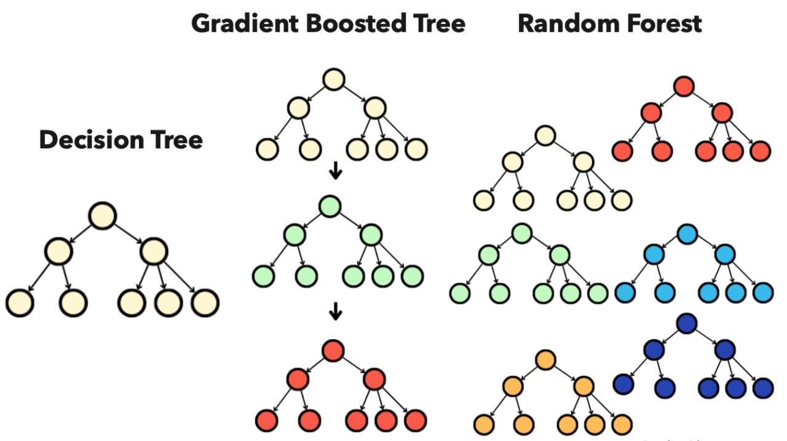
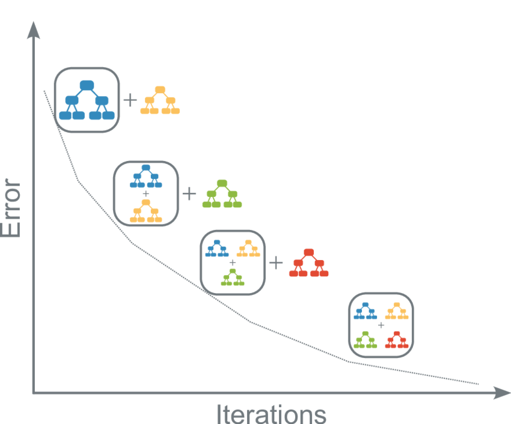

```{r setup, include=FALSE}
knitr::opts_chunk$set(echo = TRUE, fig.align = "center", message = FALSE, warning = FALSE)
library(caret)
library(tidyverse)
library(dslabs)
library(rpart)
library(randomForest)
library(gbm)
library(xgboost)
library(gridExtra)
img_path <- "treeFigs/"
```

## Learning objectives
\Large
By the end of this lecture you should be able to:

* Contrast bagging (random forests) with boosting
* Explain how boosting fits each new tree to the current residuals
* Explain the learning rate / number of trees trade-off
* Fit and tune GBMs (`gbm` via `caret`) and XGBoost (`xgboost`)
* Choose the number of boosting rounds by cross-validation (early stopping)

## Ensemble methods: bagging vs. boosting
\Large
**Ensembles** combine many **weak learners** (usually small trees) into one strong predictor.

- **Bagging** (random forests): trees built **independently**, in parallel, on bootstrap samples, then averaged. Mainly **reduces variance**.
- **Boosting** (GBM, XGBoost): trees built **sequentially**, each one correcting the errors of the ensemble so far. Mainly **reduces bias**.

## Ensemble methods: bagging vs. boosting
\center
{width="80%"}

## Boosting: the idea
\Large
Start with a constant prediction $\hat{f}_0(x) = \bar{y}$. Then for $m = 1, \ldots, M$:

1. Compute the **residuals** $r_i = y_i - \hat{f}_{m-1}(x_i)$
2. Fit a **small tree** $h_m$ to the residuals
3. Update: $\hat{f}_m(x) = \hat{f}_{m-1}(x) + \eta\, h_m(x)$

The **learning rate** $\eta$ (e.g., 0.01--0.3) makes each step small, so the model learns slowly.

## Boosting by hand: 2008 polls
Boosting **stumps** (one-split trees) on the polls data, $\eta = 0.1$:

\footnotesize
```{r boost-by-hand}
data("polls_2008")
eta <- 0.1; M <- 200
f_hat <- rep(mean(polls_2008$margin), nrow(polls_2008))
fits <- list()
for(m in 1:M){
  r <- polls_2008$margin - f_hat                         # 1. residuals
  stump <- rpart(r ~ day, data = polls_2008,             # 2. small tree
                 control = rpart.control(maxdepth = 1, cp = 0))
  f_hat <- f_hat + eta * predict(stump)                  # 3. small step
  if(m %in% c(1, 10, 50, 200)) fits[[as.character(m)]] <- f_hat
}
```

## Boosting by hand: 2008 polls
Each round adds one more small step; too many rounds would start fitting noise.

```{r boost-by-hand-plot, echo=FALSE, out.width="95%", fig.height=3, fig.width=10}
bind_rows(lapply(names(fits), function(m)
  tibble(day = polls_2008$day, margin = polls_2008$margin,
         y_hat = fits[[m]], rounds = paste(m, "rounds")))) %>%
  mutate(rounds = factor(rounds, levels = paste(names(fits), "rounds"))) %>%
  ggplot() + geom_point(aes(day, margin), size = 0.5, alpha = 0.5) +
  geom_step(aes(day, y_hat), col = "red") + facet_wrap(~rounds, nrow = 1)
```

## Gradient boosting machines (GBMs)
\Large
**Why "gradient"?** For squared error, the residual $y_i - \hat{f}(x_i)$ is the **negative gradient** of the loss.

- For other losses (log-loss for classification, Cox for survival), each tree is fit to the negative gradient ("pseudo-residuals")
- So boosting is **gradient descent**, one tree per step
- Final model: $\hat{y} = \hat{f}_0 + \eta \sum_{m=1}^M h_m(x)$

## Gradient boosting machines (GBMs)
\center
{width=50%}

## GBM tuning parameters
\Large
- **Number of trees** $M$ (`n.trees`): unlike random forests, **too many trees overfit**
- **Learning rate** $\eta$ (`shrinkage`): smaller $\eta$ needs more trees, but usually generalizes better
- **Tree depth** (`interaction.depth`): 1 = stumps (additive model); $d$ allows $d$-way interactions
- **Min. leaf size** (`n.minobsinnode`) and **row subsampling** (stochastic boosting)

## GBM example: digits 2 vs. 7
Same data as the trees lecture. Tune with 5-fold CV:

\footnotesize
```{r gbm-fit}
data("mnist_27")
set.seed(42)
ctrl <- trainControl(method = "cv", number = 5)
gbmGrid <- expand.grid(n.trees = c(50, 100, 200, 400),
                       interaction.depth = c(1, 3, 5),
                       shrinkage = 0.05, n.minobsinnode = 10)
gbm_fit <- train(y ~ ., data = mnist_27$train, method = "gbm",
                 trControl = ctrl, tuneGrid = gbmGrid, verbose = FALSE)
gbm_fit$bestTune
```

## GBM example: digits 2 vs. 7
CV accuracy across the grid:

```{r gbm-plot, out.width="55%", fig.height=4, fig.width=6}
plot(gbm_fit)
```

## GBM example: digits 2 vs. 7
Test-set accuracy (data the model never saw):

```{r gbm-test}
gbm_pred <- predict(gbm_fit, newdata = mnist_27$test)
confusionMatrix(gbm_pred, mnist_27$test$y)$overall["Accuracy"]
```

## Extreme gradient boosting (XGBoost)
\large
**XGBoost** (Chen \& Guestrin 2016) is a fast, regularized GBM implementation:

- **Regularization:** L1/L2 penalties on leaf weights and a per-split penalty ($\gamma$) in the objective
- **Speed:** parallel split-finding within each tree, histogram approximations, sparse data
- **Missing values:** learns which direction to send them at each split
- **Subsampling** of rows and columns, as in random forests

## XGBoost: data and parameters
`xgboost` needs a **numeric matrix** and **0/1 labels**:

\footnotesize
```{r xgb-data}
X_train <- as.matrix(mnist_27$train[, c("x_1", "x_2")])
y_train <- as.numeric(mnist_27$train$y == "7")     # 7 = 1, 2 = 0
X_test  <- as.matrix(mnist_27$test[, c("x_1", "x_2")])
dtrain  <- xgb.DMatrix(X_train, label = y_train)

params <- list(objective = "binary:logistic",  # outputs P(Y = 1)
               eval_metric = "logloss",
               eta = 0.05,                     # learning rate
               max_depth = 3,                  # tree depth
               subsample = 0.8,                # row subsample
               colsample_bytree = 1)           # feature subsample
```

## XGBoost: how many rounds? Early stopping
Cross-validate, and stop once the CV loss hasn't improved for 20 rounds:

\footnotesize
```{r xgb-cv, fig.show='hide'}
set.seed(42)
cv <- xgb.cv(params = params, data = dtrain, nrounds = 1000, nfold = 5,
             early_stopping_rounds = 20, verbose = 0)
log <- cv$evaluation_log
best_n <- which.min(log$test_logloss_mean)
best_n
plot(log$iter, log$test_logloss_mean, type = "l", xlab = "Boosting rounds",
     ylab = "CV log-loss")
lines(log$iter, log$train_logloss_mean, lty = 2)
```

## XGBoost: how many rounds? Early stopping
Training loss keeps falling; CV loss bottoms out (dotted line = chosen rounds):

```{r xgb-cv-plot, echo=FALSE, out.width="55%", fig.height=4, fig.width=6}
plot(log$iter, log$test_logloss_mean, type = "l", lwd = 2,
     ylim = range(c(log$test_logloss_mean, log$train_logloss_mean)),
     xlab = "Boosting rounds", ylab = "Log-loss")
lines(log$iter, log$train_logloss_mean, lty = 2, lwd = 2, col = "grey40")
abline(v = best_n, lty = 3)
legend("topright", c("CV (test folds)", "Training"), lty = 1:2,
       col = c("black", "grey40"), bty = "n")
```

## XGBoost: fit and evaluate
Refit on all training data with the chosen rounds; evaluate on the test set:

\footnotesize
```{r xgb-fit}
set.seed(42)
xgb_fit <- xgb.train(params = params, data = dtrain, nrounds = best_n)
p_hat <- predict(xgb_fit, X_test)                 # P(digit = 7)
xgb_pred <- factor(ifelse(p_hat > 0.5, "7", "2"), levels = levels(mnist_27$test$y))
confusionMatrix(xgb_pred, mnist_27$test$y)$overall["Accuracy"]
```

## Comparing the methods: digits 2 vs. 7
```{r compare-fits, include=FALSE}
set.seed(1)
tree_fit <- train(y ~ ., method = "rpart", data = mnist_27$train,
                  tuneGrid = data.frame(cp = seq(0, 0.1, len = 30)))
rf_fit <- randomForest(y ~ ., data = mnist_27$train, nodesize = 31)
acc <- function(pred) mean(pred == mnist_27$test$y)
plot_cond_prob <- function(p_hat = NULL, title = ""){
  tmp <- mnist_27$true_p
  if(!is.null(p_hat)) tmp <- mutate(tmp, p = p_hat)
  tmp %>% ggplot(aes(x_1, x_2, z = p, fill = p)) +
    geom_raster(show.legend = FALSE) +
    scale_fill_gradientn(colors = c("#F8766D", "white", "#00BFC4")) +
    stat_contour(breaks = c(0.5), color = "black") + ggtitle(title)
}
```
\large
Test-set accuracy: tree `r round(acc(predict(tree_fit, mnist_27$test)), 3)`,
random forest `r round(acc(predict(rf_fit, mnist_27$test)), 3)`,
GBM `r round(acc(gbm_pred), 3)`, XGBoost `r round(acc(xgb_pred), 3)`.

```{r compare-plot, echo=FALSE, out.width="95%", fig.height=2.6, fig.width=10}
grid.arrange(
  plot_cond_prob(predict(rf_fit, mnist_27$true_p, type = "prob")[, 2], "Random forest"),
  plot_cond_prob(predict(gbm_fit, mnist_27$true_p, type = "prob")[, 2], "GBM"),
  plot_cond_prob(predict(xgb_fit, as.matrix(mnist_27$true_p[, c("x_1", "x_2")])), "XGBoost"),
  plot_cond_prob(NULL, "Truth"), nrow = 1)
```

## XGBoost through caret
\large
`caret` wraps XGBoost as `method = "xgbTree"` (same `trainControl`, grids, ROC metrics), **but it fails with xgboost $\ge$ 3.0**. Check `packageVersion("xgboost")`; with 3.x, use `xgb.cv` directly and loop over a small grid:

\footnotesize
```{r xgb-grid, eval=FALSE}
grid <- expand.grid(max_depth = c(2, 3, 5), eta = c(0.05, 0.1))
grid$logloss <- grid$nrounds <- NA
for(i in seq_len(nrow(grid))){
  p <- modifyList(params, as.list(grid[i, c("max_depth", "eta")]))
  log <- xgb.cv(params = p, data = dtrain, nrounds = 1000, nfold = 5,
                early_stopping_rounds = 20, verbose = 0)$evaluation_log
  grid$nrounds[i] <- which.min(log$test_logloss_mean)
  grid$logloss[i] <- min(log$test_logloss_mean)
}
grid[which.min(grid$logloss), ]
```

## Random forests vs. boosting in practice
\large
| | **Random forest** | **Gradient boosting** |
| :--- | :--- | :--- |
| Trees | deep, independent | shallow, sequential |
| Main effect | lowers variance | lowers bias |
| More trees | never hurts | eventually overfits |
| Tuning | forgiving defaults | needs $\eta$, depth, rounds |
| Accuracy | strong | often best on tabular data |

\vspace{0.1cm}
\normalsize
Neither is interpretable on its own: next week, **SHAP** and **LIME**.

## Summary
\large
* Bagging averages independent trees (variance); boosting adds trees sequentially (bias)
* Each boosting tree fits the residuals, i.e., the negative gradient of the loss
* Small learning rate + more trees usually generalizes better; too many trees overfit
* Choose the number of rounds by cross-validation (early stopping)
* XGBoost: regularized, fast, handles missing data; evaluate on held-out data

## Python companion
\Large
Python versions of these examples (`scikit-learn`'s `GradientBoostingClassifier` and the `xgboost` package):

`python/week6/gradientBoost.ipynb`

## Session Info
\tiny
```{r session}
sessionInfo()
```
