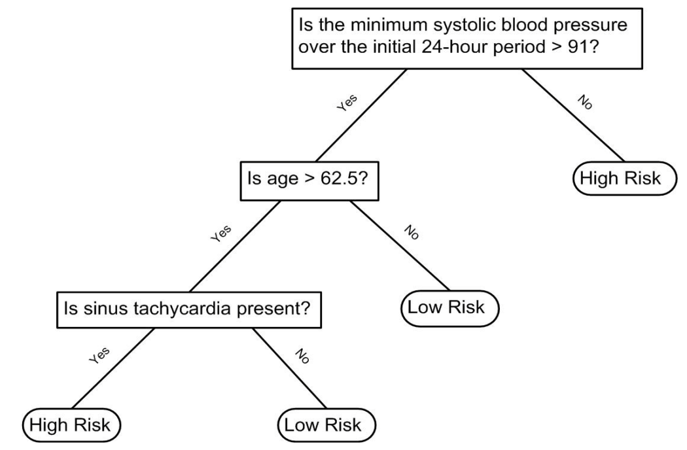

```{r setup, include=FALSE}
knitr::opts_chunk$set(echo = TRUE, fig.align = "center", message = FALSE, warning = FALSE)
library(caret)
library(tidyverse)
library(dslabs)
library(rpart)
library(randomForest)
library(kableExtra)
library(gridExtra)
img_path <- "treeFigs/"
```

## Learning objectives
\Large
By the end of this lecture you should be able to:

* Explain how a tree partitions the predictors with yes/no splits
* Fit and prune regression and classification trees (`rpart`, `caret`)
* Explain why single trees are unstable, and how bagging fixes it
* Explain the two sources of randomness in a random forest
* Tune a random forest, read its OOB error and variable importance

## Road map
\Large
One idea, built up in four steps:

1. **Olive oil** (classification): a tree as a set of yes/no rules
2. **2008 polls** (regression, one predictor): how splits are chosen; overfitting and pruning
3. **Digits 2 vs 7** (classification, two predictors): a tree's blocky boundary
4. **Random forests**: average many trees; then back to **olive oil**

# Decision trees

## Motivating example: olive oil
Composition of Italian olive oils: 8 fatty acids, 3 regions.
\small
```{r}
data("olive")
olive <- select(olive, -area) # remove `area`; we predict `region`
names(olive)
table(olive$region)
```

## Motivating example: olive oil
```{r}
olive %>% head() %>%
  knitr::kable() %>% kable_styling(font_size = 7)
```

## Motivating example: olive oil
A quick kNN fit already predicts well:
\scriptsize
```{r olive-knn, fig.height=3, fig.width=4, out.width="40%"}
fit <- train(region ~ ., method = "knn", data = olive,
             tuneGrid = data.frame(k = seq(1, 15, 2)))
ggplot(fit)
```

## Motivating example: olive oil
\large
Eicosenoic is only in Southern Italy; linoleic separates Northern Italy from Sardinia:

```{r olive-eda, fig.height=3, fig.width=6, echo=FALSE, out.width="80%"}
olive %>% gather(fatty_acid, percentage, -region) %>%
  ggplot(aes(region, percentage, fill = region)) +
  geom_boxplot() +
  facet_wrap(~fatty_acid, scales = "free", ncol = 4) +
  theme(axis.text.x = element_blank(), legend.position = "bottom")
```

## Motivating example: olive oil
\large
Two predictors should separate the regions almost perfectly:

```{r olive-two-predictors, echo=FALSE, out.width="80%", fig.height=3, fig.width=6}
olive %>%
  ggplot(aes(eicosenoic, linoleic, color = region)) +
  geom_point() +
  geom_vline(xintercept = 0.065, lty = 2) +
  geom_segment(x = -0.2, y = 10.54, xend = 0.065, yend = 10.54,
               color = "black", lty = 2)
```

## Motivating example: olive oil
\large
**Decision rule:** eicosenoic $> 0.065$ $\rightarrow$ Southern Italy; otherwise linoleic $> 10.535$ $\rightarrow$ Sardinia, else Northern Italy.

```{r olive-tree, echo=FALSE, fig.height=3, fig.width=6, out.width="90%"}
train_rpart <- train(region ~ ., method = "rpart", data = olive)
plot(train_rpart$finalModel, margin = 0.1)
text(train_rpart$finalModel, cex = 0.75)
```

## Decision trees in medicine
Trees like this are common in clinical practice, e.g., risk after a heart attack:

\center
{width=55%}

\scriptsize
([Source: Walton 2010 Informal Logic, Vol. 30, No. 2, pp. 159-184](https://papers.ssrn.com/sol3/Delivery.cfm/SSRN_ID1759289_code1486039.pdf?abstractid=1759289&mirid=1&type=2).)

## Decision trees
\Large

- A tree is a **flow chart of yes/no questions**, with predictions at the ends (**leaves**)
- **CART** (Classification and Regression Trees) predicts an outcome $Y$ by **partitioning the predictors** ${\bf X}$
- How are the splits chosen? Easiest to see with **one** predictor $\rightarrow$

## Regression trees
\large
Continuous outcome $\rightarrow$ **regression tree**. Estimate $f(x)=\mbox{E}(Y | X = x)$: $Y$ = poll margin (Obama $-$ McCain), $x$ = day.

\small
```{r polls-2008, out.width='50%', fig.height=3, fig.width=6}
data("polls_2008")
polls_2008 %>% ggplot() + geom_point(aes(day, margin))
```

## Regression trees
\Large
- Partition the predictor space into $J$ non-overlapping regions $R_1, \ldots, R_J$
- For any $x \in R_j$, predict the **average of the training $y_i$** in $R_j$
- Partitions are built **recursively**: start with one region, split it in two, then split one of those, \ldots

## Regression trees: choosing a split
\Large
At each step, search **every predictor $j$ and cutpoint $s$** and pick the split
$R_1 = \{x_j < s\}$, $R_2 = \{x_j \ge s\}$ that minimizes

$$\sum_{i:\, x_i \in R_1} (y_i - \hat{y}_{R_1})^2 + \sum_{i:\, x_i \in R_2} (y_i - \hat{y}_{R_2})^2$$

A **greedy** search: the best split *now*, not the best tree overall.

## Regression trees
\Large
Fit with the `rpart` function in the __rpart__ package:

```{r}
fit <- rpart(margin ~ ., data = polls_2008)
```

## Regression trees
The splits:

```{r polls-2008-tree, fig.height=5, fig.width=7, out.width="70%", echo=FALSE}
plot(fit, margin = 0.1)
text(fit, cex = 0.75)
```

## Regression trees
First split at day $-39.5$, then $-86.5$, and so on. The estimate $\hat{f}(x)$ is a step function:

\footnotesize
```{r polls-2008-tree-fit, out.width='50%', fig.height=3, fig.width=6}
polls_2008 %>%
  mutate(y_hat = predict(fit)) %>% ggplot() +
  geom_point(aes(day, margin)) + geom_step(aes(day, y_hat), col = "red")
```

## Regression trees: when to stop?
\Large
- Each split **lowers training RSS**
- Split until every point is its own region $\rightarrow$ RSS $= 0$ (**overfitting**)
- `rpart` stops a split unless it improves fit by the **complexity parameter `cp`**
- Also: **`minsplit`** (min. observations to split a node, default 20) and **`minbucket`** (min. per leaf)

## Regression trees
`cp = 0` and `minsplit = 2`: the tree just reproduces the data:

\footnotesize
```{r polls-2008-tree-over-fit, out.width='50%', fig.height=3, fig.width=6}
fit <- rpart(margin ~ ., data = polls_2008,
             control = rpart.control(cp = 0, minsplit = 2))
polls_2008 %>%
  mutate(y_hat = predict(fit)) %>% ggplot() +
  geom_point(aes(day, margin)) + geom_step(aes(day, y_hat), col = "red")
```

## Regression trees
**Pruning** cuts back an existing tree to a larger `cp`:
\footnotesize
```{r polls-2008-prune, out.width='55%', fig.height=3, fig.width=6}
pruned_fit <- prune(fit, cp = 0.01)
polls_2008 %>% mutate(y_hat = predict(pruned_fit)) %>% ggplot() +
  geom_point(aes(day, margin)) + geom_step(aes(day, y_hat), col = "red")
```

## Regression trees
How to pick `cp`? **Cross-validation:**

\footnotesize
```{r polls-2008-tree-train, out.width='40%', fig.height=3, fig.width=6}
train_rpart <- train(margin ~ ., method = "rpart",
                     tuneGrid = data.frame(cp = seq(0, 0.05, len = 25)),
                     data = polls_2008)
ggplot(train_rpart)
```

## Regression trees
The final tree (`finalModel`):
\footnotesize
```{r polls-2008-final-model, fig.height=5, fig.width=7, out.width="60%"}
plot(train_rpart$finalModel, margin = 0.1)
text(train_rpart$finalModel, cex = 0.75)
```

## Regression trees
With one predictor we can plot $\hat{f}(x)$:
\footnotesize
```{r polls-2008-final-fit, out.width='60%', fig.height=3, fig.width=6}
polls_2008 %>%
  mutate(y_hat = predict(train_rpart)) %>% ggplot() +
  geom_point(aes(day, margin)) + geom_step(aes(day, y_hat), col = "red")
```

## Classification (decision) trees
\Large
Used when the **outcome is categorical**. Two changes from regression trees:

- **Predict** the *most common class* in each partition (not the average)
- **Split** to make partitions **pure**, using the **Gini index** or **entropy** (instead of RSS)

## Classification (decision) trees
\Large
Let $\hat{p}_{j,k}$ be the proportion of class $k$ in partition $j$:

$$\mbox{Gini}(j) = \sum_{k=1}^K \hat{p}_{j,k}(1-\hat{p}_{j,k}) \qquad
\mbox{entropy}(j) = -\sum_{k=1}^K \hat{p}_{j,k}\log(\hat{p}_{j,k})$$

- Both are **$0$** when a partition is pure (one class); $0 \times \log(0)$ is defined as 0
- Both grow as the classes get more mixed

## Classification (decision) trees
Digits 2 vs. 7, predicted from two pixel summaries ($x_1$, $x_2$):
```{r mnist27-data, echo=FALSE, out.width="62%", fig.height=4, fig.width=8}
data("mnist_27")

plot_cond_prob <- function(p_hat = NULL){
  tmp <- mnist_27$true_p
  if(!is.null(p_hat)){
    tmp <- mutate(tmp, p = p_hat)
  }
  tmp %>% ggplot(aes(x_1, x_2, z = p, fill = p)) +
  geom_raster(show.legend = FALSE) +
  scale_fill_gradientn(colors = c("#F8766D", "white", "#00BFC4")) +
  stat_contour(breaks = c(0.5), color = "black")
}

p1 <- mnist_27$train %>%
  ggplot(aes(x_1, x_2, col = y)) + geom_point() +
  ggtitle("Scatterplot of the data")
p2 <- plot_cond_prob() + ggtitle("True conditional probability")
grid.arrange(p1, p2, nrow = 1)
```

## Classification (decision) trees
Tuning the complexity parameter:
\footnotesize
```{r mnist-27-tree, out.width="55%", fig.height=3, fig.width=6}
set.seed(1)
train_rpart <- train(y ~ ., method = "rpart", data = mnist_27$train,
                     tuneGrid = data.frame(cp = seq(0.0, 0.1, len = 30)))
plot(train_rpart)
```

## Classification (decision) trees
Test-set accuracy:

```{r}
y_hat <- predict(train_rpart, mnist_27$test)
confusionMatrix(y_hat, mnist_27$test$y)$overall["Accuracy"]
```

## Classification (decision) trees
The estimated boundary is **blocky**: every split is parallel to an axis.

```{r tree-cond-prob, echo=FALSE, out.width="70%", fig.height=4, fig.width=8}
p1 <- plot_cond_prob() + ggtitle("True conditional probability")
p2 <- plot_cond_prob(predict(train_rpart, newdata = mnist_27$true_p, type = "prob")[,2]) +
  ggtitle("Decision Tree")
grid.arrange(p2, p1, nrow = 1)
```

## Trees: strengths and weaknesses
\Large
**Strengths:**

* Highly interpretable; easy to draw (if small)
* Mimic human decision rules; no dummy variables needed

**Weaknesses:**

* Easy to overfit; rarely the most accurate method
* **High variance:** small changes in the data can change the first split, and so the whole tree

# Random forests

## Random forests
\Large
**Random forests** fix the instability of single trees by **averaging many trees** (Breiman 2001):

1. **Build** $B$ trees $T_1, \ldots, T_B$, each made randomly different
2. **Predict** each case with every tree: $\hat{y}_b$ from tree $T_b$
3. **Combine:** average $\hat{y} = \frac{1}{B}\sum_{b=1}^B \hat{y}_b$ (regression) or **majority vote** (classification)

## Random forests: two sources of randomness
\Large
1. **Bootstrap the rows:** each tree is fit to $N$ observations sampled *with replacement* (**bagging** = bootstrap aggregation)
2. **Sample the predictors:** at **each split**, only a random subset of `mtry` predictors is considered

\vspace{0.2cm}
Step 2 **decorrelates** the trees (one strong predictor can't dominate every tree), so averaging reduces variance more.

## Random forests
Polls data, __randomForest__ package. (One predictor, so this forest is just **bagging**.)

\small
```{r polls-2008-rf}
fit <- randomForest(margin ~ ., data = polls_2008)
fit
```

## Random forests
Error vs. number of trees: it levels off after about 30 trees.

```{r more-trees-better-fit, out.width="55%", fig.height=4, fig.width=6}
plot(fit, main = '')
```

## Random forests
The forest's estimate is much smoother than a single tree:
\footnotesize
```{r polls-2008-rf-fit, out.width='60%', fig.height=3, fig.width=6}
polls_2008 %>%
  mutate(y_hat = predict(fit, newdata = polls_2008)) %>% ggplot() +
  geom_point(aes(day, margin)) + geom_line(aes(day, y_hat), col = "red")
```

## Random forests: averaging bootstrap trees
Grey: trees from individual bootstrap samples. Blue: their average.

```{r rf-animation, echo=FALSE, out.width="82%", fig.height=3.2, fig.width=9}
set.seed(1)
ntrees <- 50
XLIM <- range(polls_2008$day)
YLIM <- range(polls_2008$margin)

if(knitr::is_html_output()){
  knitr::include_graphics(file.path(img_path, "rf.gif"))
} else {
  sum <- rep(0, nrow(polls_2008))
  res <- vector("list", ntrees)
  show <- c(1, 5, 25, 50)
  par(mfrow = c(1, 4), mar = c(4, 4, 2, 1))
  for(i in 1:ntrees){
    ind <- sort(sample(1:nrow(polls_2008), replace = TRUE))
    tmp <- polls_2008[ind, ]
    fit_b <- rpart(margin ~ day, data = tmp)
    res[[i]] <- tibble(day = tmp$day, margin = predict(fit_b, newdata = tmp))
    sum <- sum + predict(fit_b, newdata = polls_2008)
    avg <- sum / i
    if(i %in% show){
      with(tmp, plot(day, margin, pch = 1, xlim = XLIM, ylim = YLIM, type = "n",
                     xlab = "Days", ylab = "Obama - McCain",
                     main = ifelse(i == 1, paste(i, "tree"), paste(i, "trees"))))
      for(j in 1:i){
        with(res[[j]], lines(day, margin, type = "s", col = "grey", lty = 2))
      }
      with(tmp, points(day, margin, pch = 1))
      with(res[[i]], lines(day, margin, type = "s", col = "azure4", lwd = 2))
      lines(polls_2008$day, avg, lwd = 3, col = "blue")
    }
  }
}
```

## Random forests: digits
Back to digits 2 vs. 7:

```{r mnist-27-rf-fit}
set.seed(1)
train_rf <- randomForest(y ~ ., data = mnist_27$train)
confusionMatrix(predict(train_rf, mnist_27$test),
                mnist_27$test$y)$overall["Accuracy"]
```

## Random forests: digits
```{r cond-prob-rf, echo=FALSE, out.width="70%", fig.height=4, fig.width=8}
p1 <- plot_cond_prob() + ggtitle("True conditional probability")
p2 <- plot_cond_prob(predict(train_rf, newdata = mnist_27$true_p, type = "prob")[,2]) +
  ggtitle("Random Forest")
grid.arrange(p2, p1, nrow = 1)
```

## Random forests: tuning node size
\large
More accurate, but the estimate is noisy. A larger **minimum node size** (points per leaf) gives a smoother estimate; tune it with __caret__:

\footnotesize
```{r acc-versus-nodesize, fig.show='hide'}
set.seed(1)
nodesize <- seq(1, 51, 10)
acc <- sapply(nodesize, function(ns){
  train(y ~ ., method = "rf", data = mnist_27$train,
        tuneGrid = data.frame(mtry = 2),
        nodesize = ns)$results$Accuracy })
plot(nodesize, acc)
```

## Random forests: tuning node size
```{r acc-versus-nodesize-plot, echo=FALSE, out.width="60%", fig.height=4, fig.width=6}
plot(nodesize, acc, type = "b", pch = 19, xlab = "Minimum node size",
     ylab = "Bootstrap accuracy")
```

## Random forests: tuning node size
Refit with the best node size and evaluate on the test set:

```{r}
set.seed(1)
train_rf_2 <- randomForest(y ~ ., data = mnist_27$train,
                           nodesize = nodesize[which.max(acc)])
confusionMatrix(predict(train_rf_2, mnist_27$test),
                mnist_27$test$y)$overall["Accuracy"]
```

## Random forests: tuning node size
A smoother estimate, closer to the truth:

```{r cond-prob-final-rf, echo=FALSE, out.width="70%", fig.height=4, fig.width=8}
p1 <- plot_cond_prob() + ggtitle("True conditional probability")
p2 <- plot_cond_prob(predict(train_rf_2, newdata = mnist_27$true_p, type = "prob")[,2]) +
  ggtitle("Random Forest")
grid.arrange(p2, p1, nrow = 1)
```

## Out-of-bag (OOB) error: validation for free
\Large
- Each bootstrap sample leaves out $\approx 1/3$ of the cases (**out-of-bag**)
- Predict each case using only the trees that **never saw it**
- Average over cases $\rightarrow$ an **honest error estimate** without a separate validation set
- `randomForest()` prints it as the "OOB estimate of error rate"

## Back to olive oil
A random forest on all 8 fatty acids (`importance = TRUE` for permutation importance):

\small
```{r olive-rf}
set.seed(1)
olive_rf <- randomForest(region ~ ., data = olive, importance = TRUE)
olive_rf$confusion   # OOB confusion matrix
```

\normalsize
OOB error rate: `r round(100 * tail(olive_rf$err.rate[, "OOB"], 1), 1)`%.

## Variable importance
\large
Forests lose the tree's interpretability. **Variable importance** recovers some of it:

- **Permutation importance** (`MeanDecreaseAccuracy`): shuffle one predictor in the OOB data; how much does accuracy drop?
- **Impurity importance** (`MeanDecreaseGini`): total decrease in Gini from splits on that predictor, summed over all trees
- `caret::varImp()` extracts importance from any supported model

## Variable importance: olive oil
Eicosenoic tops the list. Oleic ranks with linoleic: the two are strongly correlated ($r \approx -0.85$), so they share the credit.

\small
```{r olive-varimp, out.width="52%", fig.height=2.4, fig.width=6}
imp <- importance(olive_rf, type = 1)  # permutation importance
par(mar = c(4, 7, 1, 1))
barplot(sort(imp[, 1]), horiz = TRUE, las = 1,
        xlab = "Mean decrease in accuracy")
```

## Variable importance: cautions
\Large
- **Correlated predictors share importance:** two co-expressed genes split the credit, so each can look weak
- **Impurity importance is biased** toward continuous and many-level predictors (more possible cutpoints); permutation importance is less so
- Importance is **predictive, not causal**
- More on explaining models (SHAP, LIME) next week

## Trees \& forests in practice
\Large
**When are random forests a good choice?**

- **Non-linear** effects and **interactions** among predictors
- **Mixed** predictor types, minimal preprocessing (no scaling needed)
- **Many predictors**, even $p \gg N$ (e.g., genes)
- Strong performance with **little tuning**

## Trees \& forests in practice
\Large
**Knobs (and sensible defaults):**

- **`ntree`**: enough trees for the error curve to flatten (often 500)
- **`mtry`**: predictors tried per split; $\approx \sqrt{p}$ (classification), $p/3$ (regression)
- **`nodesize`**: larger $\rightarrow$ smoother, less overfitting

\vspace{0.2cm}
Tune `mtry` and node size by **cross-validation**. `ranger` is a fast implementation (`method = "ranger"` in caret).

## Trees \& forests in practice
\large
**Omics / high-dimensional data ($p \gg N$):**

- Forests handle **thousands of genes** with few samples
- With many noise genes, a small `mtry` can miss the signal: **tune it**
- **Class imbalance** (e.g., rare disease): use class weights, balanced sampling, or a tuned cutoff
- **Never judge performance on training data**: use OOB, cross-validation, or a held-out test set

## Summary
\large
* A tree partitions the predictors with greedy yes/no splits (RSS for regression, Gini/entropy for classification)
* Trees overfit unless stopped or pruned (`cp`, `minsplit`); choose `cp` by cross-validation
* Single trees are interpretable but unstable (high variance)
* Random forests average bootstrap trees and sample `mtry` predictors at each split
* OOB error gives honest validation for free
* Variable importance helps interpret forests, but beware correlated predictors

## Python companion
\Large
Python versions of these examples (`scikit-learn`'s `DecisionTreeRegressor`, `DecisionTreeClassifier`, `RandomForestClassifier`):

`python/week6/trees.ipynb`

## Acknowledgments
\large
Examples, figures, and several explanations are adapted from R. A. Irizarry, *Introduction to Data Science* (the `dslabs` book) --- licensed CC BY-NC-SA.

\vspace{0.4cm}
This deck was edited by Claude AI.

## Session Info
\tiny
```{r session}
sessionInfo()
```
