```{r setup, include=FALSE}
knitr::opts_chunk$set(echo = TRUE, fig.align = "center", message = FALSE, warning = FALSE)
library(caret)
library(tidyverse)
library(neuralnet)
library(nnet)
library(pROC)
img_path <- "nnFigs/"
```

##
\vfill
\begin{center}
{\huge\itshape ``Biology / Biomedicine is a Data Science.''}

\vspace{0.6cm}

{\large --- W. Evan Johnson}

\vspace{0.4cm}

{\large\itshape Addendum: don't avoid the math!}
\end{center}
\vfill

##
\vfill
\begin{center}
{\huge\itshape ``With great power comes great responsibility.''}

\vspace{0.8cm}

{\large --- Uncle Ben, \emph{Spider-Man}}
\end{center}
\vfill

## Learning objectives
\Large
By the end of this lecture you should be able to:

* Describe an artificial neuron: weights, bias, activation function
* Explain how a network learns: loss, backpropagation, gradient descent
* Fit and tune a multilayer perceptron in R (`neuralnet`, `nnet` via `caret`)
* Explain what convolutional and recurrent networks add, and why
* Describe the key idea of transformers: attention

## A quick map of "AI"
\Large
Where do neural networks fit in the broader AI landscape?

- **Narrow AI** (all AI today): does one specific task well --- Face ID, spam filters, recommendations, Google Maps, ChatGPT
- **Generative AI**: creates new content from learned patterns --- text, images, music, video, voice
- **Agentic AI** (emerging): takes actions, makes plans, and uses tools to accomplish goals --- schedules meetings, sends email, runs tasks automatically

## A quick map of "AI"
\Large

- **Artificial General Intelligence (AGI)**: human-level reasoning across many tasks --- **theoretical; does not exist** (movies exaggerate it)
- **Artificial Super Intelligence (ASI)**: hypothetical intelligence that would *surpass* humans across virtually all domains --- **also does not exist**

\vspace{0.3cm}
Everything we build today --- including the neural networks in this lecture --- is **Narrow AI**.

## Real (human) intelligence
\Large
The ability to think, choose, create, understand meaning, and act with moral responsibility:

- **Agency** --- we choose
- **Moral judgment** --- right vs. wrong
- **Creativity** --- truly new ideas
- **Understanding meaning**
- **Empathy and relationships**
- **Spiritual capacity**

##
\vfill
\begin{center}
{\huge\itshape ``AI will not replace us, it will amplify us.''}

\vspace{0.8cm}

{\large --- Pedro Domingos}
\end{center}
\vfill

# From neurons to networks

## Biological neurons
\Large
The brain has billions of neurons, each a simple processor, wired into a **biological neural network** that passes electrical signals from neuron to neuron:

- **Dendrites** --- receive input signals
- **Soma** (cell body) --- sums the inputs
- **Axon $\rightarrow$ synapses** --- pass the output on to other neurons

## Biological neurons
\center
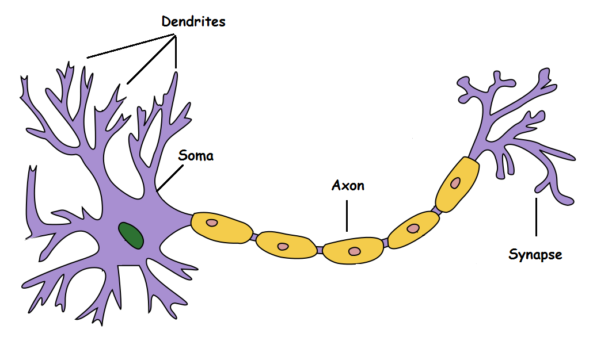{width=85%}

## McCulloch \& Pitts (1943)
\Large
The first mathematical model of a neuron:

- Binary inputs, fixed weights, and a **threshold**: fire (1) or not (0)
- **No layers and no training rule**
- Networks of such units can compute logical functions: the brain as a computing device

## McCulloch \& Pitts (1943)
\center
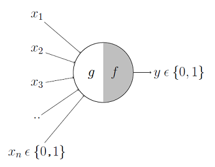{width=50%}

## The perceptron (Rosenblatt, 1957--58)
\Large
The first **trainable** neural network: one layer of adjustable weights and a threshold, learned from labeled examples.

\center
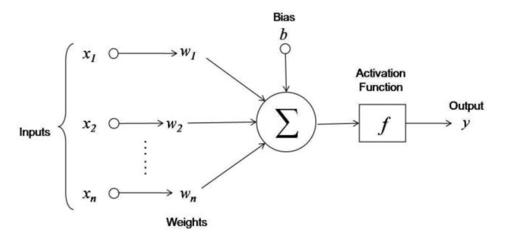{width=70%}

## A short history
\Large
- **1943:** McCulloch \& Pitts neuron
- **1958:** Rosenblatt's perceptron
- **1969:** Minsky \& Papert, *Perceptrons*: a single-layer perceptron can't learn simple functions like XOR $\rightarrow$ interest collapses
- **1986:** Rumelhart, Hinton \& Williams popularize **backpropagation** for multilayer networks
- **2012:** AlexNet (deep CNN + GPUs) wins ImageNet $\rightarrow$ the **deep learning** era

## An artificial neuron
\Large
$$\text{output} = g\Big(\sum_{j=1}^p w_j x_j + b\Big)$$

- **Inputs** $x_1,\ldots,x_p$: the predictors
- **Weights** $w_j$ and **bias** $b$: the parameters we learn
- **Activation function** $g$: maps the weighted sum to the output

With $g$ = logistic, a single neuron **is logistic regression**.

## Activation functions
\Large
The activation function gives the network its **non-linearity**:

- **Identity**: output = input (linear; regression outputs)
- **Binary step**: on/off above a threshold (the original perceptron)
- **Sigmoid / tanh**: smooth S-curves; sigmoid gives probabilities
- **ReLU** $\max(0,x)$: the modern default for hidden layers
- **Softmax**: turns $K$ outputs into class probabilities

## Activation functions
\center
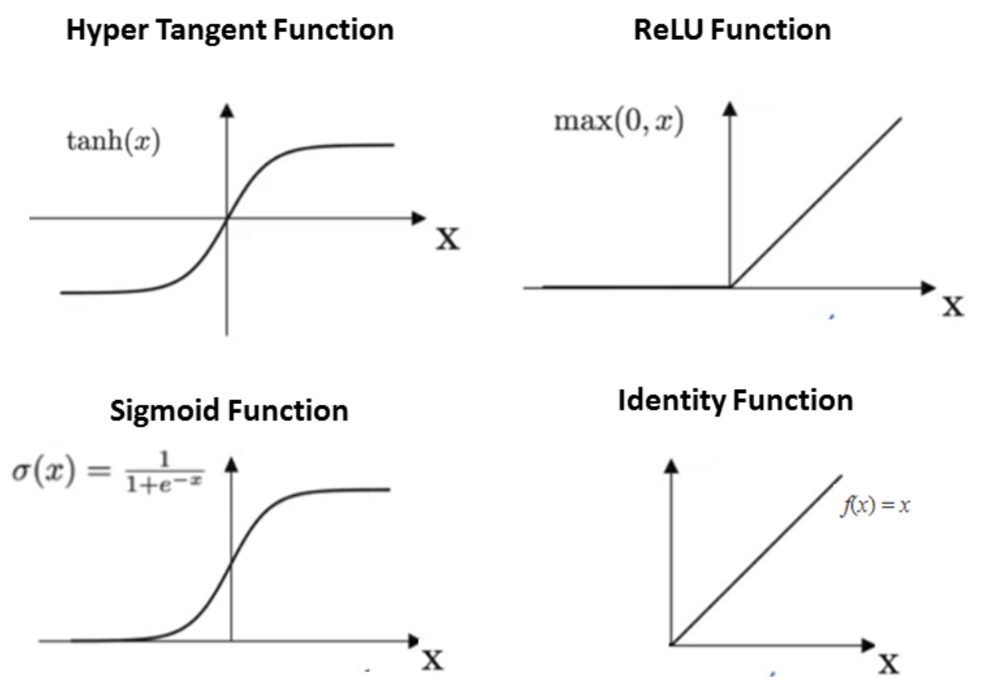{width=60%}

## Multilayer networks
A **multilayer perceptron** (MLP) stacks layers of neurons: input $\rightarrow$ hidden layer(s) $\rightarrow$ output. "**Deep**" = many hidden layers.
\center
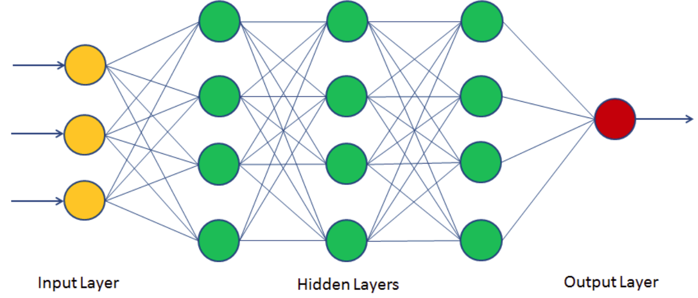{width=65%}

# How networks learn

## How does a neural network learn?
\Large
Training means finding the **weights** that make predictions match the data:

1. A **loss** $\ell(y, \hat{y})$: how wrong is the prediction? (squared error, cross-entropy)
2. **Backpropagation**: how does each weight affect the loss?
3. **Gradient descent**: nudge each weight to reduce the loss

##
\vfill
\begin{center}
{\huge\itshape ``AI is not magic; it's math.''}

\vspace{0.8cm}

{\large --- Peter Norvig}
\end{center}
\vfill

## The chain rule
\center
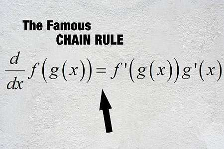{width=70%}

## The chain rule
\Large
A neural network is **functions composed inside functions**. The derivative of a composition multiplies the derivatives of each layer:
\center
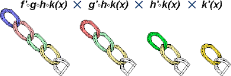{width=95%}

## Backpropagation
\Large
The chain rule sends the error **backward** through the network, giving the gradient of the loss for **every weight**:
\center
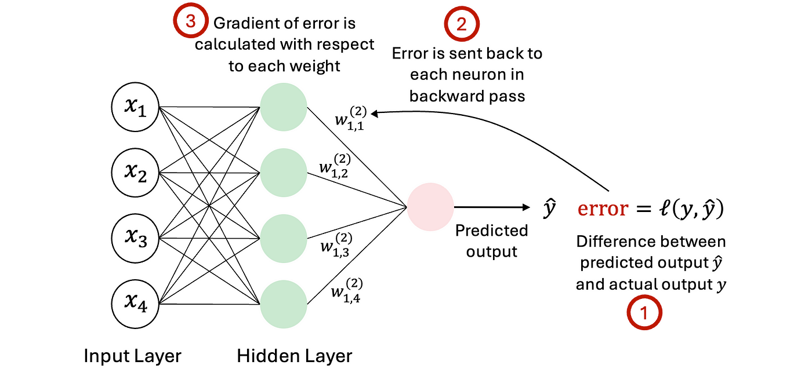{width=75%}

## Gradient descent
\large
Update each weight against its gradient: $w \leftarrow w - \eta\, \partial \ell / \partial w$ (learning rate $\eta$). In practice, **stochastic** gradient descent uses small **mini-batches**; one pass through the data is an **epoch**.
\center
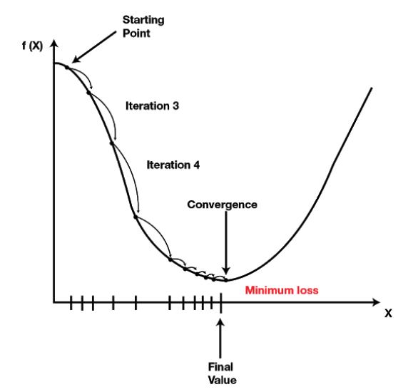{height=52%}

## Training in practice
\Large
Networks have many weights, so they **overfit** easily:

- **Weight decay** (L2 penalty): regularization again (`decay` in `nnet`)
- **Early stopping**: stop when validation loss stops improving
- **Dropout**: randomly switch off neurons during training
- **Scale the inputs**; start from **random weights** (results vary by seed)

# Neural networks in R

## A toy example: job placement
Technical knowledge (TKS) and communication skill (CSS) scores (rescaled to 0--1), and placement:

```{r}
df <- data.frame(TKS    = c(20, 10, 30, 20, 80, 30) / 100,
                 CSS    = c(90, 20, 40, 50, 50, 80) / 100,
                 Placed = c(1, 0, 0, 0, 1, 1))
df
```

## A toy example: job placement
A multilayer perceptron with one hidden layer of 3 neurons:
\footnotesize
```{r toy-nn}
set.seed(0)
nn <- neuralnet(Placed ~ TKS + CSS, data = df, hidden = 3,
                act.fct = "logistic", linear.output = FALSE)
```

```{r toy-nn-plot, echo=FALSE, out.width="60%", fig.height=4, fig.width=7}
plot(nn, rep = "best", information = FALSE, show.weights = FALSE)
```

## A toy example: job placement
Predict for three new students; threshold at 0.5:

```{r}
test <- data.frame(TKS = c(30, 40, 85) / 100, CSS = c(85, 50, 40) / 100)
prob <- predict(nn, test)
cbind(test, prob = round(prob, 3), pred = ifelse(prob > 0.5, 1, 0))
```

\large
With 6 training points, this is an illustration, not a model!

## Iris: three classes
\small
`neuralnet` fits one output neuron per class (inputs scaled first; unscaled, it fails to converge):
```{r iris-nn, out.width="50%", fig.height=4.5, fig.width=7}
iris_s <- mutate(iris, across(where(is.numeric), ~ as.numeric(scale(.x))))
set.seed(0)
nn_iris <- neuralnet(Species ~ ., data = iris_s, hidden = 3, linear.output = FALSE)
plot(nn_iris, rep = "best", information = FALSE, show.weights = FALSE)
```

## Tuning with caret: `nnet`
\large
`method = "nnet"`: one hidden layer; tune its **size** and the weight **decay**. Train/test split, as always:

\footnotesize
```{r iris-caret}
set.seed(0)
idx <- createDataPartition(iris$Species, p = 0.7, list = FALSE)
nn_caret <- train(Species ~ ., data = iris[idx, ], method = "nnet",
                  preProcess = c("center", "scale"), trace = FALSE)
nn_caret$bestTune
confusionMatrix(predict(nn_caret, iris[-idx, ]),
                iris$Species[-idx])$overall["Accuracy"]
```

## Tuning with caret: `nnet`
```{r iris-plotnet, fig.height=6, fig.width=10, out.width="65%"}
NeuralNetTools::plotnet(nn_caret$finalModel)
```

## Biomarker development revisited: TB
\small
The TB NanoString data from the SVM lecture, same split and CV:
\footnotesize
```{r tb-nn}
tb <- readRDS("TBnanostring.rds")
tb$TB_Status <- factor(tb$TB_Status, levels = c("LTBI", "TB"))
set.seed(1)
idx <- createDataPartition(tb$TB_Status, p = 0.7, list = FALSE)
tb_train <- tb[idx, ]; tb_test <- tb[-idx, ]
ctrl <- trainControl(method = "cv", number = 10, classProbs = TRUE,
                     summaryFunction = twoClassSummary)
set.seed(1)
nn_tb <- train(TB_Status ~ ., data = tb_train, method = "nnet",
               preProcess = c("center", "scale"), metric = "ROC", trControl = ctrl,
               tuneGrid = expand.grid(size = c(1, 3, 5), decay = c(0.01, 0.1, 1, 2)),
               trace = FALSE, maxit = 500)
nn_tb$bestTune
```

## Biomarker development revisited: TB
\small
```{r tb-nn-test}
p_tb <- predict(nn_tb, tb_test, type = "prob")[, "TB"]
auc(roc(tb_test$TB_Status, p_tb, levels = c("LTBI", "TB"),
        direction = "<", quiet = TRUE))
confusionMatrix(predict(nn_tb, tb_test), tb_test$TB_Status,
                positive = "TB")$byClass[c("Sensitivity", "Specificity")]
```

\large
Test AUC $\approx$ the SVMs (0.92--0.93), with **strong weight decay** chosen. With 125 samples and 107 genes, a neural net has no edge.

## When does deep learning shine?
\Large
- **Large** data sets (thousands to millions of examples)
- **Raw, structured inputs**: images, sequences, text, audio
- The network **learns the features** that we would otherwise hand-engineer
- For small **tabular** data (most clinical and omics studies), regularized regression, forests, and boosting are usually as good and easier to tune

# Network architectures

## Feedforward vs. recurrent
\Large
- **Feedforward**: signals travel one way, layer to layer, input to output (the MLP)
- **Recurrent**: contains a loop: the hidden state from the previous step is fed back in, giving the network **memory**
- **Convolutional**: shares weights across positions in an image or sequence

\vspace{0.2cm}
\normalsize
Others: LSTM/GRU, sequence-to-sequence, radial basis function networks, autoencoders, transformers.

## Convolutional neural networks
\Large
A **CNN** is specialized for **grid-like data** such as images:

- Small **filters (kernels)** with **shared weights** slide across the input $\rightarrow$ **feature maps**
- A pattern is detected **wherever it appears** (translation equivariance; pooling adds approximate invariance)
- Far fewer weights than a fully connected MLP: a built-in **regularization**

## Convolutional neural networks
\Large
- **Filters are learned** from data, not hand-engineered
- Early layers find edges; later layers find shapes and objects
- Uses: medical imaging, pathology slides, video, genomic sequences

\center
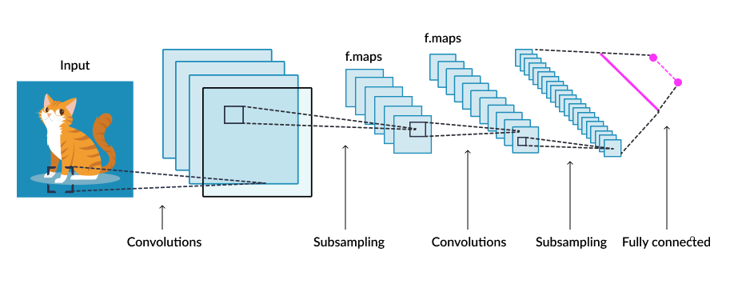{width=80%}

## Convolutional neural networks
\Large
**Pooling** (here, max pooling) shrinks each feature map:
\center
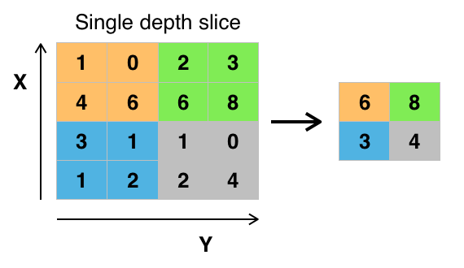{width=70%}

## Convolutional neural networks
\Large
A sliding (overlapping) filter: **kernel**, **stride**, and **padding**:
\center
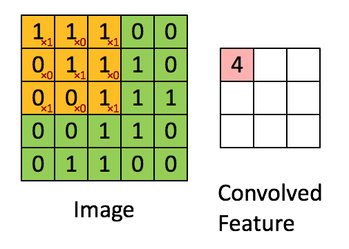{width=49%} 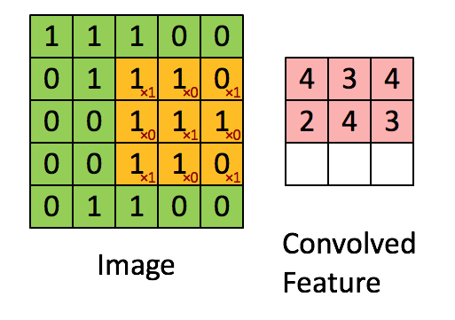{width=49%}

## Convolutional neural networks
\Large
Now applying this to cats:
\center
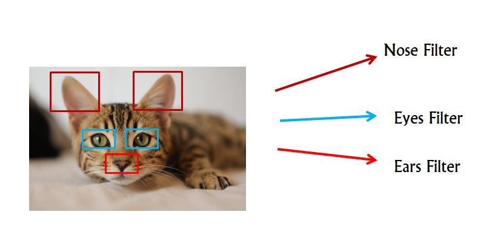{width=80%}

## Convolutional neural networks
\Large
More realistically:
\center
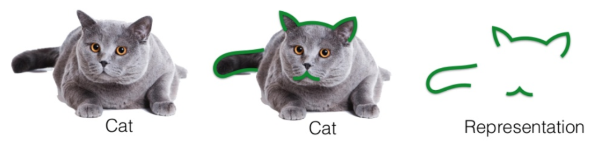

## Convolutional neural networks
\Large
And as a classifier:
\center
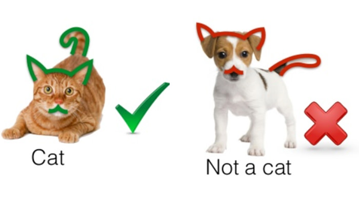{width=80%}

## Recurrent neural networks
\Large
- For **sequential data**: text, time series, speech, sequences
- Standard networks assume **independent inputs**, but sequences have **dependencies**: in *"The cat sat on the \_\_\_"*, you need the previous words
- A **hidden state** carries memory from one step to the next

## RNN architecture
\Large
The same weights are applied at every time step $t$:

- Input: $x_t$
- Hidden state: $h_t = f(W x_t + U h_{t-1} + b)$
- Output: $y_t = g(V h_t + c)$

## Diagram of an RNN (unrolled)
\center
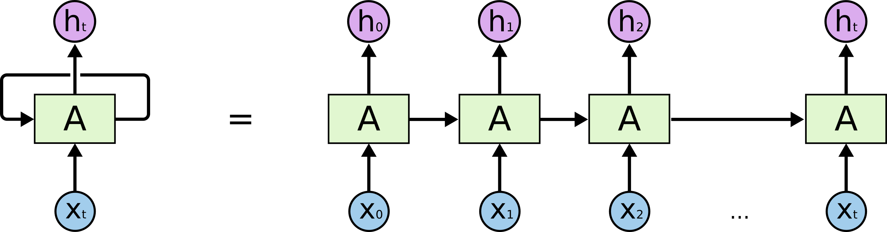

## Challenges of RNNs
\Large
- **Vanishing/exploding gradients**: backpropagating through many time steps multiplies many derivatives
- Hard to learn long-range dependencies
- Fixes: **LSTM** (long short-term memory) and **GRU** (gated recurrent unit) cells

## RNN for language translation
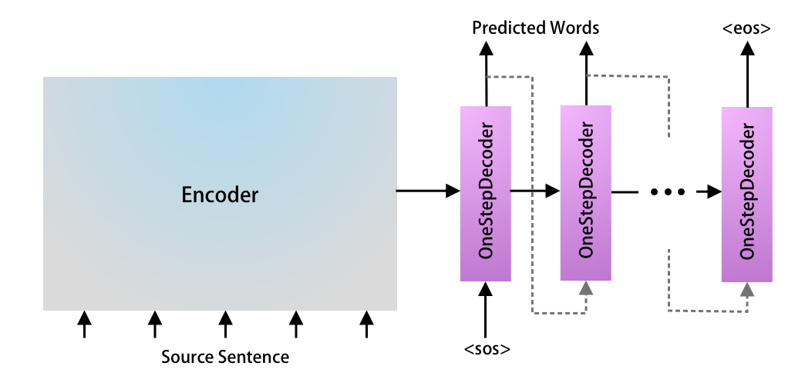

## RNN for language translation
\center
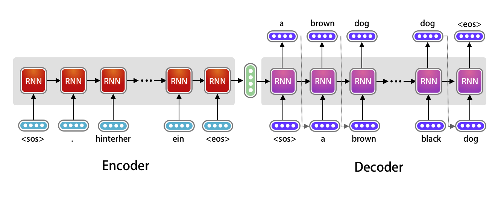

## RNN for language translation
\center
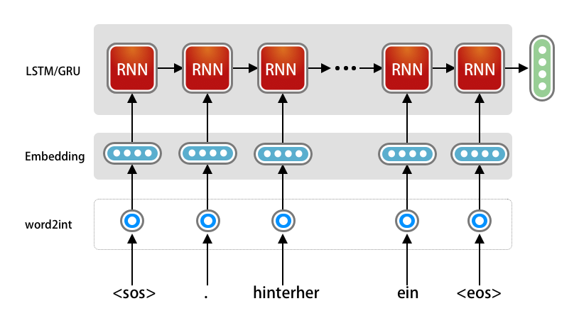{width=80%}

## RNN for language translation
\center
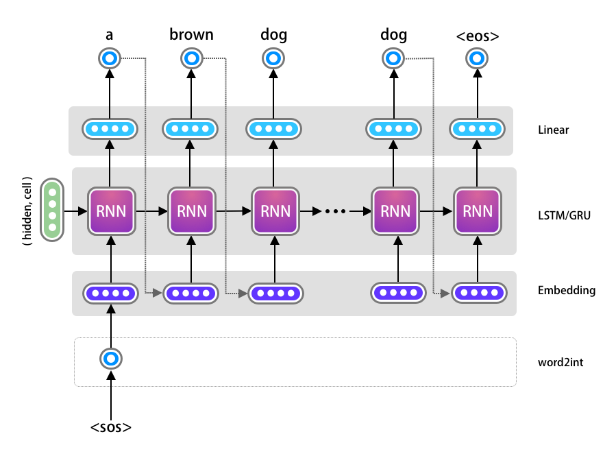{height=62%}

## From RNNs to transformers
\Large
- RNNs process a sequence **one step at a time**: slow, and memory fades
- **Transformers** process the **entire sequence at once**, using **attention**
- Introduced in *"Attention Is All You Need"* (Vaswani et al., 2017)

## Transformers: encoder--decoder
\center
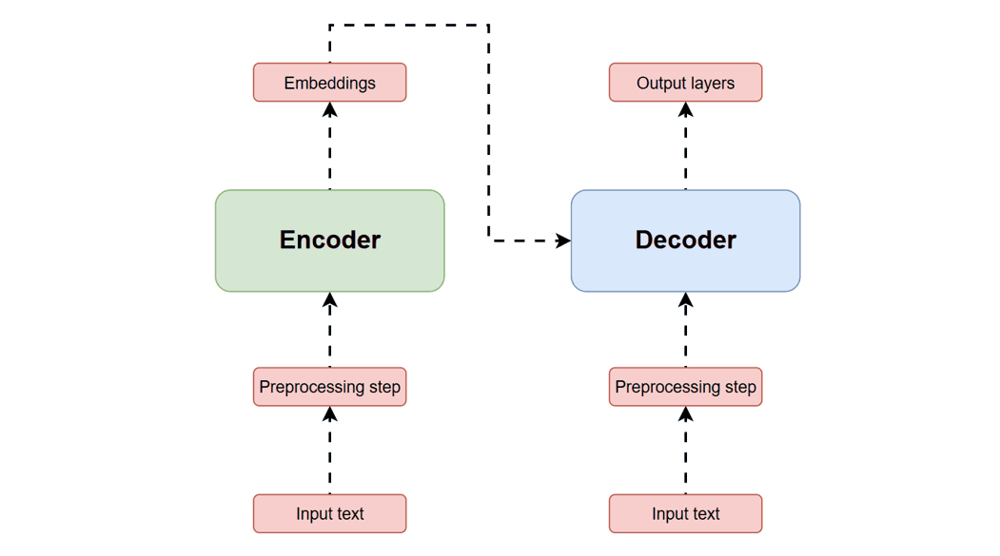{width=75%}

## Key idea: attention
\Large
- Each token **looks at every other token** and decides which ones matter
- Example: in translation, each output word attends to the relevant source words
- For queries $Q$, keys $K$, values $V$:
$$\text{Attention}(Q, K, V) = \text{softmax}\left( \frac{QK^T}{\sqrt{d_k}} \right) V$$

## Transformer architecture
\large
- **Multi-head** self-attention: several attention "heads" learn different relationships
- **Positional encoding** adds word order (there is no recurrence)
- Each block: attention + feedforward network, with residual connections and layer normalization
- Original transformer: **encoder + decoder** (translation). **BERT**: encoder only. **GPT**: decoder only.

## Transformer architecture
\center
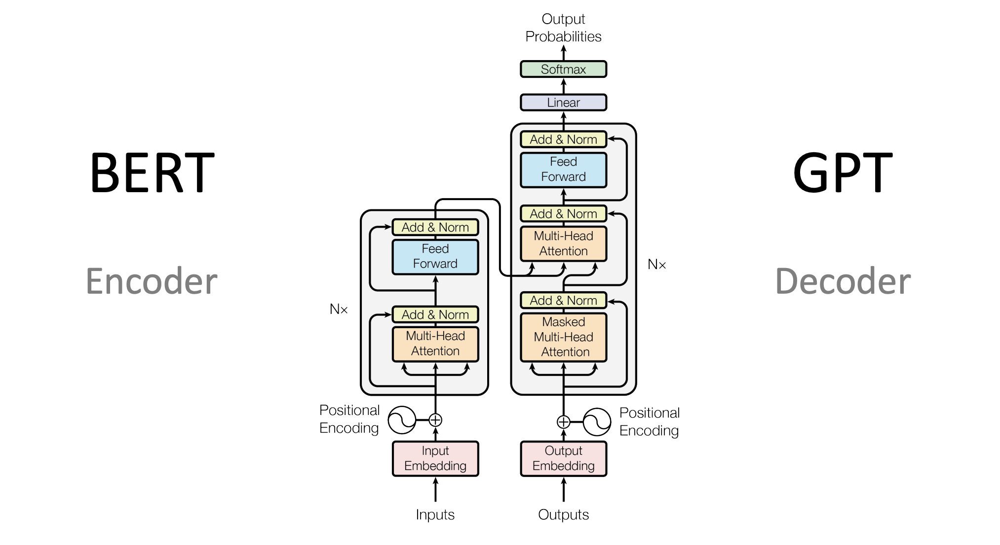{height=70%}

## GPT: a very advanced autocomplete
\Large
**GPT** = **G**enerative **P**retrained **T**ransformer. At its core, it predicts the next word (token):

- Looks at **all** the previous words at once
- Assigns **probabilities** to possible next words
- Picks a likely next word, then repeats

\vspace{0.1cm}
More on generative AI and LLMs in the coming weeks.

## Summary
\large
* A neuron: weighted sum + bias + non-linear activation; an MLP stacks layers of them
* Training: a loss, backpropagation (chain rule), and gradient descent
* Networks overfit easily: weight decay, early stopping, dropout; tune by CV
* On small tabular data (TB NanoString), an MLP matched but didn't beat SVMs
* CNNs share filters across images; RNNs carry memory along sequences
* Transformers replace recurrence with attention: the basis of today's LLMs

## Python companion
\Large
Python versions of these examples (`scikit-learn`'s `MLPClassifier`):

`python/week7/neuralNet.ipynb`

## Session Info
\tiny
```{r session}
sessionInfo()
```
